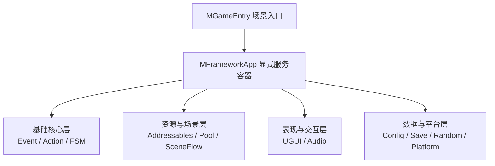

# MFramework 中文使用手册

MFramework 是面向团结引擎与 Unity 制作的独立游戏运行时框架。当前 UPM 包名为 `com.mstudio.mframework`，公开命名空间统一为 `MFramework`（在任何脚本中只需一行 `using MFramework;` 即可使用全部功能）。



## 文档导航

- **[使用手册](manual/index.md)**：各模块的接入方法、最小使用示例和使用边界。
- **[API 参考](api/index.md)**：按 14 个模块检索公开类、接口、结构体、枚举及成员签名。

## 5 分钟快速上手示例

在常驻 Bootstrap 场景中创建一个 `GameObject`，挂载继承自 `MGameEntry` 的入口脚本：

```csharp
using MFramework;
using UnityEngine;

public sealed class MyGameEntry : MGameEntry
{
    [SerializeField] private MUIRoot uiRoot;
    [SerializeField] private GameObject audioHost;

    protected override void Configure(MFrameworkApp app)
    {
        // 1. 显式注册所需模块（按注册顺序正序初始化，退出时逆序关闭）
        app.Register<IMEventBus>(new MEventBus())
           .Register(new MActionRunner())
           .Register(new MPool())
           .Register(new MConfig())
           .Register(new MAudio(audioHost))
           .Register(new MSceneFlow());

        // 2. 注册 UI 服务与路由器
        MUIService ui = uiRoot.CreateService();
        app.Register(ui)
           .Register(new MUIRouter(ui));
    }
}
```

## 14 个模块速查表

| 模块 | 主要入口类型 | 使用手册 |
| :--- | :--- | :--- |
| **Core 核心** | `MFrameworkApp`、`MGameEntry`、`MDisposableBag` | [Core 手册](manual/core.md) |
| **Event 事件** | `MEventBus`、`IMEventBus` | [Event 手册](manual/event.md) |
| **Action 动作** | `MAction`、`MActionRunner`、`MActionHandle` | [Action 手册](manual/action.md) |
| **FSM 状态机** | `MStateMachine<TContext>`、`IMState<TContext>` | [FSM 手册](manual/state-machine.md) |
| **Pool 对象池** | `MPool`、`MPoolKey`、`IMPooledGameObject` | [Pool 手册](manual/pool.md) |
| **Addressables 资源** | `MAddressables`、`MAssetScope`、`MAssetLease<T>` | [Addressables 手册](manual/addressables.md) |
| **SceneFlow 场景流** | `MSceneFlow`、`MSceneFlowPlan`、`MSceneFlowRequest` | [SceneFlow 手册](manual/scene-flow.md) |
| **UGUI 界面导航** | `MUIRoot`、`MUIService`、`MUIRouter`、`MUIView` | [UGUI 手册](manual/ugui.md) |
| **Config 配置校验** | `MConfig`、`MConfigAsset`、`MConfigValidationContext` | [Config 手册](manual/config.md) |
| **Audio 音频** | `MAudio`、`MAudioId` | [Audio 手册](manual/audio.md) |
| **Platform 平台** | `MPlatformService`、`IMPlatformBridge` | [Platform 手册](manual/platform.md) |
| **Extensions 扩展** | `MVectorExtensions`、`MDisposableExtensions` | [Extensions 手册](manual/extensions.md) |
| **Random 随机源** | `MRandom`、`MRandomState`、`IMRandomSource` | [Random 手册](manual/random.md) |
| **Save 可靠存档** | `MSave<T>`、`MFileSaveStorage` | [Save 手册](manual/save.md) |
